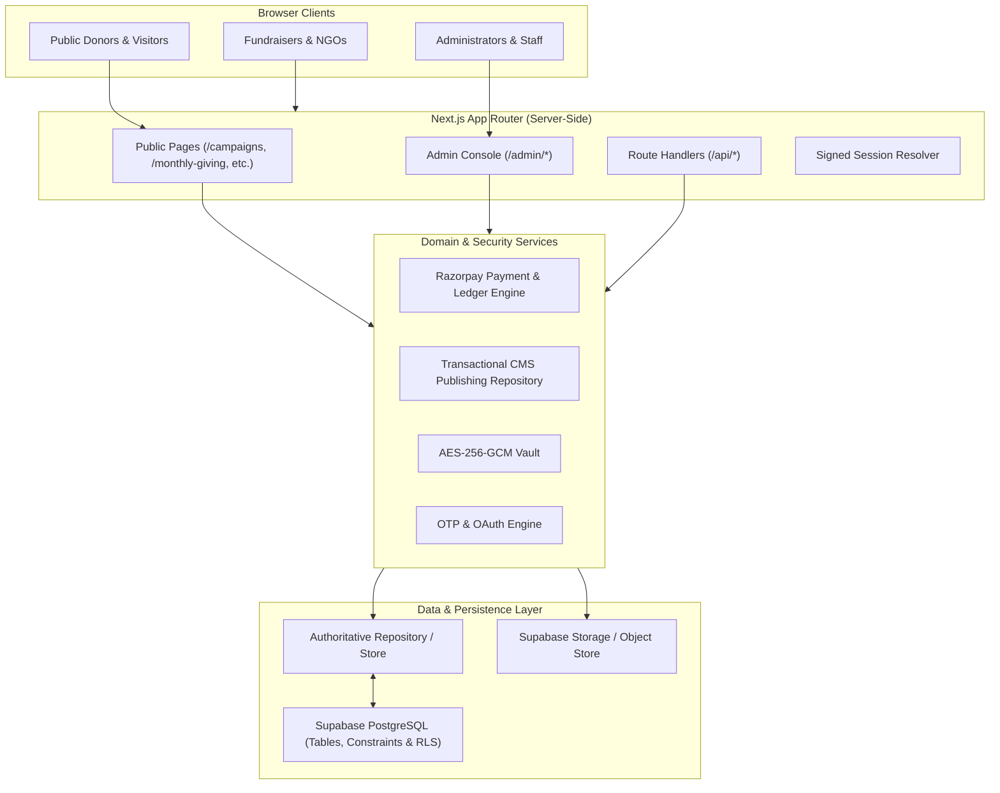

# Dokind Technical Architecture & System Design

> **BRANDING DIRECTIVE:** The public-facing product name is **Dokind** only.

---

## 1. Architectural Overview

Dokind is built as a unified Next.js App Router application with strict boundaries between presentation, domain services, database repositories, and external providers.

---

## 2. Core Architectural Principles

### 2.1 Single Authoritative Source of Truth
- **DatabaseStore & PostgreSQL**: Application entities (Campaigns, Donations, Users, Organizations, CMS Versions, Audit Logs) have a single authoritative repository.
- There are no competing parallel state stores in memory, localStorage, or JSON files. Local storage is strictly used for client UI convenience (e.g. tab selections) and never treated as financial or permission authority.

### 2.2 Payment Integrity & Timing-Safe Verification
- Server creates Razorpay orders authoritatively with validated INR minor units (paise).
- Client-supplied prices and totals are discarded.
- Signatures are verified using `crypto.timingSafeEqual` over HMAC-SHA256 calculations.
- Webhook events are processed idempotently with duplicate prevention based on unique event identifiers.
- Refunds require authorized finance role permissions and reverse both campaign funds and supporter counts in a single atomic transaction.

### 2.3 Transactional Page Publishing & Versioning
- **Drafts (`page_drafts`)**: Dedicated draft tables allowing content editors to stage, preview, and revise sections without mutating live public pages.
- **Published Versions (`page_published_versions`)**: Immutable snapshots with monotonic version numbering. A database unique constraint and transaction guarantees that exactly one version is marked `is_active = TRUE` at any given time.
- **Instant Rollback**: Restoring a historical version generates a new active version snapshot, preserving complete audit lineage.

### 2.4 Cryptographic Vault for Third-Party Gateways
- Stored third-party credentials (payment gateway keys, SMS credentials, webhook secrets) are encrypted using authenticated `aes-256-gcm`.
- Ciphertexts include initialization vector (IV) and authentication tag to prevent ciphertext tampering.
- Master keys are derived from high-entropy environment variables (`ENCRYPTION_MASTER_KEY` / `AUTH_SECRET`).

### 2.5 Role-Based Access Control (RBAC)
- 11 distinct staff and user roles: `donor`, `fundraiser`, `organization_manager`, `support_staff`, `head_staff`, `reviewer`, `finance`, `campaign_manager`, `content_writer`, `content_editor`, `admin`, `super_admin`.
- Maximum-Two-Roles constraint enforced server-side for all staff accounts.
- Public registrations default strictly to `donor`.
- Privileged operations verify session validity, suspension status, and granular permissions on every request.
