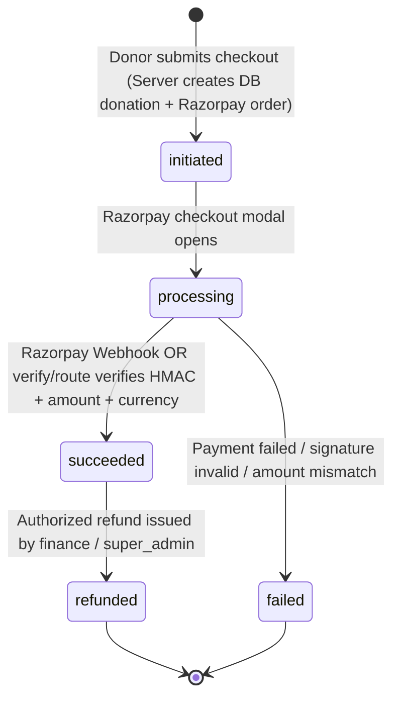

# Dokind Security Architecture Specification

**Status:** Approved & Enforced  
**Version:** 2.0 (Production Security Overhaul)  
**Date:** October 28, 2026  
**Audience:** Platform Engineers, Security Reviewers, Compliance Auditors  

---

## 1. Architectural Philosophy & Defense-in-Depth

Dokind is an open donation and medical crowdfunding platform processing sensitive personal donor information, KYC documents, and real financial transactions via Razorpay. The core architecture must enforce **zero trust on the client side**:
1. **Server-Enforced Authority:** The browser/client never dictates identity, roles, or permissions. All authorization checks occur on the server (Next.js App Router Server Components, Server Actions, and Route Handlers) or within the database (PostgreSQL / Supabase Row Level Security).
2. **Fail-Closed Default:** If an authentication token, signature, database connection, encryption key, or authorization check cannot be definitively validated, the system must immediately reject the request with HTTP 401 or 403.
3. **Strict Separation of Public Donor and Administrative Surfaces:** Donors and public visitors authenticate via dedicated public workflows (Email OTP, SMS OTP, Google OAuth) and are constrained strictly to the `donor` role. Administrative personnel authenticate through `/admin/login` using strict username/email credentials with server-validated cryptographic password hashes and MFA.
4. **Idempotent, Tamper-Proof Payment State Machine:** All financial state changes require authoritative Razorpay verification against pre-existing database donation amounts and currencies. Webhooks must be verified cryptographically and processed with persistent idempotency.

---

## 2. Authoritative Server Session Model

### 2.1 Cookie Construction & Cryptography
The platform session is managed via a single authoritative HTTP cookie: `dokind_session`.

- **Attributes:**
  - `HttpOnly: true` — Inaccessible to JavaScript (`document.cookie` cannot read or write the cookie).
  - `Secure: true` (in production) — Transmitted solely over HTTPS.
  - `SameSite: Lax` — Prevents cross-site request forgery while permitting top-level navigation.
  - `Path: /` — Available across all application routes.
  - `Max-Age: 604800` (7 days) or session-bound.
- **Payload & Signature:**
  The cookie value is formatted as:
  ```
  <base64url_encoded_payload>.<hmac_sha256_signature>
  ```
  Where:
  - `payload`: Contains JSON object `{ id, username, email, role, name, status, sessionId, issuedAt, expiresAt }`.
  - `signature`: `crypto.createHmac('sha256', AUTH_SECRET).update(base64Payload).digest('base64url')`.
- **Validation Rules:**
  - In production (`NODE_ENV === 'production'`), unsigned or legacy JSON cookies are unconditionally rejected.
  - Time-constant comparison (`crypto.timingSafeEqual`) is mandatory for signature validation.
  - Expired tokens (`Date.now() > expiresAt`) are rejected and cleared.
  - Revoked sessions or accounts marked `status: 'suspended'` are rejected immediately.

### 2.2 Client-Side Session Hydration
The client-side `AuthContext` (`src/lib/auth/context.tsx`) does not mint, sign, or write cookies.
- On initialization, the client invokes `GET /api/admin/auth/me` or `GET /api/auth/me` to retrieve read-only user state from the verified server session.
- Functions such as `switchRole()` and synthetic mock credentials are completely disabled in production environments.
- Logouts invoke `POST /api/auth/logout`, instructing the server to delete the `dokind_session` cookie via `Set-Cookie` with an expired timestamp.

---

## 3. Server-Side Data Access Layer (DAL) & Authorization Engine

All sensitive data access, page rendering, and API executions must pass through the Server DAL (`src/lib/auth/server.ts` and `src/lib/security/guards.ts`).

### 3.1 Core Security Guards

```typescript
// 1. Mandatory authenticated session guard
export async function requireAuthenticatedUser(): Promise<UserSession> {
  const session = await getServerSession();
  if (!session || session.status === 'suspended') {
    throw new UnauthorizedError('Authentication required');
  }
  return session;
}

// 2. Role-based access control guard
export async function requireRole(allowedRoles: UserRole[]): Promise<UserSession> {
  const session = await requireAuthenticatedUser();
  if (!allowedRoles.includes(session.role)) {
    throw new ForbiddenError('Insufficient permissions');
  }
  return session;
}

// 3. Administrative access guard
export async function requireAdminRole(): Promise<UserSession> {
  const ADMIN_ROLES: UserRole[] = [
    'super_admin',
    'admin',
    'finance',
    'reviewer',
    'campaign_manager',
    'content_editor',
    'content_writer',
    'marketer',
    'support_staff',
    'head_staff'
  ];
  return requireRole(ADMIN_ROLES);
}

// 4. Resource ownership / IDOR guard
export async function requireResourceOwnership(resourceOwnerId: string, resourceOwnerEmail?: string): Promise<UserSession> {
  const session = await requireAuthenticatedUser();
  // Super admin can access for administrative purposes
  if (session.role === 'super_admin' || session.role === 'admin') {
    return session;
  }
  const isOwner = session.id === resourceOwnerId || (resourceOwnerEmail && session.email === resourceOwnerEmail);
  if (!isOwner) {
    throw new ForbiddenError('Access denied: You do not own this resource');
  }
  return session;
}
```

---

## 4. Separation of Public vs Administrative Authentication

```
                    +------------------------------------+
                    |       Public Visitor / Donor       |
                    +------------------------------------+
                                      |
                      +---------------+---------------+
                      |                               |
             [Public /login Form]            [Google OAuth Callback]
                      |                               |
              (Email/Phone OTP)                       |
                      |                               |
                      v                               v
             +-----------------+             +-----------------+
             | Verify Code API |             | Exchange Token  |
             +-----------------+             +-----------------+
                      |                               |
                      +---------------+---------------+
                                      |
                                      v
                      [Role Assigned STRICTLY as 'donor']
                                      |
                                      v
                        [Redirected to /account]
```

```
                    +------------------------------------+
                    |        Platform Administrator      |
                    +------------------------------------+
                                      |
                            [/admin/login Form]
                                      |
                      (Identifier + Password + MFA OTP)
                                      |
                                      v
                        [POST /api/admin/auth/login]
                                      |
                       +--------------+--------------+
                       |                             |
              [Verify Password Hash]          [Verify MFA Code]
                       |                             |
                       +--------------+--------------+
                                      |
                                      v
                      [Resolve Staff Role from Database]
                                      |
                                      v
                 [Mint Signed HttpOnly dokind_session Cookie]
                                      |
                                      v
                        [Redirected to /admin/*]
```

- **Rule 1:** The public login routes (`/login`, `/signup`, `/api/auth/email-otp/verify`, `/api/auth/google/callback`) will **NEVER** issue an administrative role (`super_admin`, `admin`, `finance`, etc.). Any account created or authenticated via public channels defaults strictly to `role: 'donor'`.
- **Rule 2:** The administrative login route (`/api/admin/auth/login`) rejects any account with `role: 'donor'` or `status: 'suspended'`.

---

## 5. Role-Permission Matrix (RBAC)

The platform supports 13 roles across three operational tiers:
1. **Tier 1 — Root / Administrative:** `super_admin`, `admin`
2. **Tier 2 — Operational Staff:** `finance`, `reviewer`, `campaign_manager`, `content_editor`, `content_writer`, `marketer`, `support_staff`, `head_staff`
3. **Tier 3 — External / Public:** `organization_manager`, `fundraiser`, `donor`

| Capability | super_admin | admin | finance | reviewer | campaign_mgr | content_editor | donor |
| :--- | :---: | :---: | :---: | :---: | :---: | :---: | :---: |
| Platform Settings & Vault Keys | Yes | No | No | No | No | No | No |
| User Role Assignment | Yes | No | No | No | No | No | No |
| Issue Donor Refunds | Yes | No | Yes | No | No | No | No |
| Export Financial Ledgers | Yes | Yes | Yes | No | No | No | No |
| Approve NGO KYC (80G/12A) | Yes | Yes | No | Yes | No | No | No |
| Approve Campaigns to Active | Yes | Yes | No | Yes | Yes | No | No |
| Publish CMS Layouts | Yes | Yes | No | No | No | Yes | No |
| View Own Donation History | Yes | Yes | Yes | Yes | Yes | Yes | Yes |
| View Other Donors' Data | Yes | Yes | Yes | No | No | No | **NO (IDOR)** |

---

## 6. Razorpay Payment Lifecycle & State Machine



### 6.1 Critical Verification Controls
1. **Authoritative Order Creation (`/api/donations/create-order`):**
   - The donation record is created in the database first with `status: 'initiated'`.
   - The order amount sent to Razorpay is calculated on the server (`totalAmount * 100`).
2. **Webhook & Verification Route (`/api/webhooks/razorpay` & `/api/donations/verify`):**
   - **Signature Verification:** Validates `X-Razorpay-Signature` with `RAZORPAY_WEBHOOK_SECRET` using `crypto.timingSafeEqual`.
   - **Amount Matching:** Validates `paymentEntity.amount === Math.round(donation.totalAmount * 100)`. Any discrepancy transitions the donation to `failed` and triggers an urgent security alert.
   - **Currency Matching:** Validates `paymentEntity.currency === donation.currency`.
   - **Persistent Idempotency:** The payment ID (`razorpay_payment_id`) is recorded in the database. Duplicate webhook events return `HTTP 200 { status: 'already_processed' }` without double-crediting campaign totals.

---

## 7. Database Security & Row Level Security (RLS)

1. **Supabase PostgreSQL Policies:**
   - Public read access is granted only to active campaigns, verified NGO profiles, and published CMS pages.
   - Donations: Donors may read only records where `donor_id = auth.uid()` or matching verified session. Staff with `finance` or `super_admin` can read all records.
   - KYC Documents & Audit Logs: Public access is denied; access restricted to `service_role` and verified administrative sessions.
2. **Fail-Closed Secrets Management:**
   - The AES-256-GCM crypto vault (`src/lib/security/crypto-vault.ts`) throws fatal exceptions in production if `ENCRYPTION_MASTER_KEY` or `AUTH_SECRET` is unset.
   - The database client (`src/lib/db/index.ts`) fails closed in production if required database connection strings are absent.
